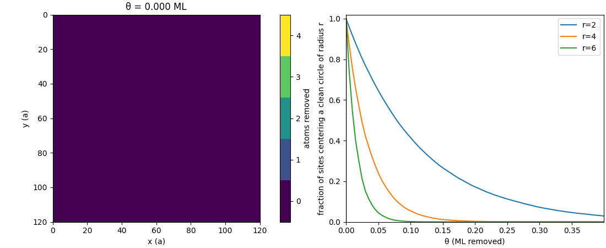
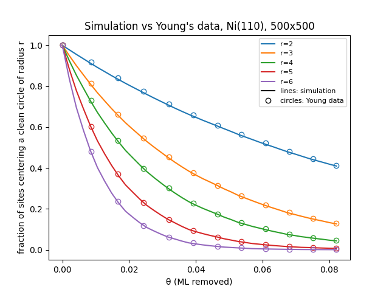

## Simulating Ion Sputter damage on Ni(110)
A Monte Carlo simulation tracking how clean patches of Ni(110) shrink while continually bombarded by sputtered ions. Aims to reproduce the model from Young, Warner & Heskett, Surface Science 644, 64–68 (2015).


### Model
 - **Lattice**: A rectangular, periodic grid of cells, one atom each, is constructed using NumPy. Ni(110) has a unit cell of $a \times a/\sqrt{2}$.
 - **Damage**: Each ion strikes a random cell, and removes one atom from it, as well as one from 0, 1, or 2 neighbors, with closer neighbors being more likely to be selected.
 - **Analysis**: For each undamaged site, find the largest possible circle around it containing no damage. Then, compute f(theta, r), the fraction of the surface centering a clean circle of radius r.

### Usage

```bash
python3 run.py       # simulate, and plot f(theta, r) to figs/run.png
python3 animate.py   # runs simulation, saves a gif like the one above to figs/sputter.gif
python3 comp.py      # runs simulation, plots and overlays vs Young' data
```
Parameters like (lattice size, seed, spacing, radii, how long to sputter) are constants at the top of the file

In `run.py`:
```python
SIZE = 400
SEED = 0
SPACING = (1.0, 1.0)

... etc
```

### Result
I reproduced Young's results, and did so much more efficiently than his original Mathematica implementation (in large part due to better tools).



You can see that the lines follow the circles in the above plot, after scale adjustment.
